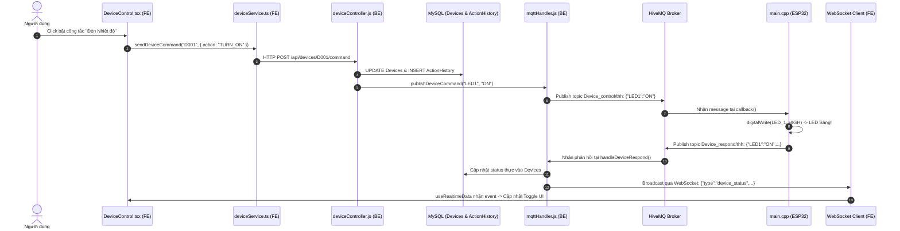
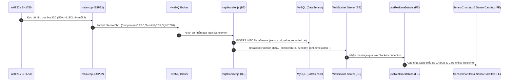
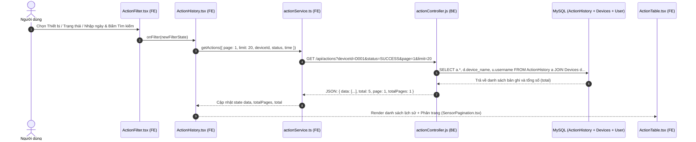
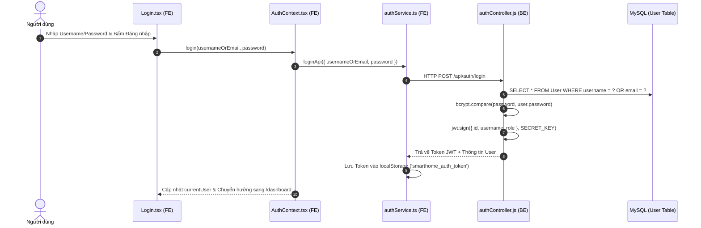

# TÀI LIỆU CHI TIẾT LUỒNG DỮ LIỆU HỆ THỐNG IOT (DATA FLOW SPECIFICATION)

> Tài liệu này mô tả chi tiết toàn bộ các luồng dữ liệu tương tác khi người dùng thao tác từ Frontend (FE), đi qua Backend (BE), Database (MySQL), MQTT Broker, cho đến khi tác động lên phần cứng thực tế (ESP32) và ngược lại.  
> **Mỗi bước đều có định danh chính xác vị trí file (File Location), hàm (Function/Handler) và chuẩn giao tiếp tương ứng.**

---

## 🗺️ Sơ đồ Kiến trúc Tổng thể (Architecture Diagram)

```
[ FRONTEND (React + Vite + TS) ]
        │ ▲              │ ▲
        │ │ (HTTP/REST)  │ │ (WebSocket)
        ▼ │              ▼ │
[ BACKEND (Node.js + Express) ] ── (SQL Query) ── [ MySQL Database ]
        │ ▲
        │ │ (MQTT Protocol - TCP 1883)
        ▼ │
[ MQTT BROKER (broker.hivemq.com) ]
        │ ▲
        │ │ (MQTT Topics: Sensor/thh, Device_control/thh, Device_respond/thh)
        ▼ │
[ HARDWARE (ESP32 Lolin C3 Mini) ]
        ├── I2C Bus: Cảm biến AHT20 (Nhiệt/Ẩm) & BH1750 (Ánh sáng)
        └── GPIOs: 3 Đèn LED (GPIO 1, 2, 21)
```

---

## 1. 🔘 LUỒNG 1: Người Dùng Bật / Tắt Thiết Bị (LED) Từ Giao Diện Web

Đây là luồng điều khiển hai chiều: Người dùng gạt công tắc trên Web $\rightarrow$ Lệnh truyền tới ESP32 bật/tắt LED thật $\rightarrow$ ESP32 phản hồi trạng thái thực tế về lại Web để cập nhật giao diện.



### Chi tiết từng bước & Vị trí File:

| Bước | Tên thành phần | Vị trí File (File Location) | Hành động / Code xử lý |
|:---:|:---|:---|:---|
| **1** | **Component Giao diện** | [`Phan_mem/FE/src/components/dashboard/DeviceControl.tsx`](file:///c:/Users/Admin/Documents/PlatformIO/Projects/lolin_c3_mini/Phan_mem/FE/src/components/dashboard/DeviceControl.tsx) | Người dùng click vào thẻ `DeviceCard`. Hàm `handleToggle()` kích hoạt lệnh `TURN_ON` hoặc `TURN_OFF`. |
| **2** | **Frontend Service** | [`Phan_mem/FE/src/services/deviceService.ts`](file:///c:/Users/Admin/Documents/PlatformIO/Projects/lolin_c3_mini/Phan_mem/FE/src/services/deviceService.ts) | Hàm `sendDeviceCommand(deviceId, command)` đóng gói payload và gọi qua `apiFetch`. |
| **3** | **API Fetch Wrapper** | [`Phan_mem/FE/src/services/api.ts`](file:///c:/Users/Admin/Documents/PlatformIO/Projects/lolin_c3_mini/Phan_mem/FE/src/services/api.ts) | Tự động đính kèm Header `Authorization: Bearer <token>` và gửi HTTP POST request. |
| **4** | **Vite Proxy (Dev)** | [`Phan_mem/FE/vite.config.ts`](file:///c:/Users/Admin/Documents/PlatformIO/Projects/lolin_c3_mini/Phan_mem/FE/vite.config.ts) | Điều hướng `/api/*` từ port `5500` sang Backend port `5000`. |
| **5** | **Backend Route** | [`Phan_mem/BE/routes/devices.js`](file:///c:/Users/Admin/Documents/PlatformIO/Projects/lolin_c3_mini/Phan_mem/BE/routes/devices.js) | Định tuyến `POST /:id/command` qua middleware xác thực `authMiddleware.js`. |
| **6** | **Backend Controller** | [`Phan_mem/BE/controllers/deviceController.js`](file:///c:/Users/Admin/Documents/PlatformIO/Projects/lolin_c3_mini/Phan_mem/BE/controllers/deviceController.js) | Hàm `sendDeviceCommand()`:<br>1. Tìm `mqtt_key` (`LED1`/`LED2`/`LED3`).<br>2. Cập nhật bảng `Devices`.<br>3. Ghi log vào bảng `ActionHistory`.<br>4. Gọi `mqttHandler.publishDeviceCommand()`. |
| **7** | **Database Pool** | [`Phan_mem/BE/config/database.js`](file:///c:/Users/Admin/Documents/PlatformIO/Projects/lolin_c3_mini/Phan_mem/BE/config/database.js) | Thực thi câu lệnh SQL `UPDATE Devices...` và `INSERT INTO ActionHistory...`. |
| **8** | **Backend MQTT Service** | [`Phan_mem/BE/services/mqttHandler.js`](file:///c:/Users/Admin/Documents/PlatformIO/Projects/lolin_c3_mini/Phan_mem/BE/services/mqttHandler.js) | Hàm `publishDeviceCommand()` publish chuỗi JSON `{"LED1":"ON"}` lên topic `Device_control/thh` tới `broker.hivemq.com`. |
| **9** | **ESP32 Firmware Callback** | [`Phan_cung/src/main.cpp`](file:///c:/Users/Admin/Documents/PlatformIO/Projects/lolin_c3_mini/Phan_cung/src/main.cpp) | Hàm `callback(topic, payload)` giải mã JSON bằng `ArduinoJson`.<br>Thực hiện `digitalWrite(LED_1, HIGH)` $\rightarrow$ **Đèn LED vật lý bật sáng**. |
| **10** | **ESP32 Respond** | [`Phan_cung/src/main.cpp`](file:///c:/Users/Admin/Documents/PlatformIO/Projects/lolin_c3_mini/Phan_cung/src/main.cpp) | Hàm `publishDeviceRespond()` gửi trạng thái 3 LED lên topic `Device_respond/thh`. |
| **11** | **Backend MQTT Handler** | [`Phan_mem/BE/services/mqttHandler.js`](file:///c:/Users/Admin/Documents/PlatformIO/Projects/lolin_c3_mini/Phan_mem/BE/services/mqttHandler.js) | Hàm `handleDeviceRespond()` cập nhật trạng thái mới nhất vào DB và gọi `broadcast('device_status', data)`. |
| **12** | **Frontend WebSocket Hook** | [`Phan_mem/FE/src/services/mqttService.ts`](file:///c:/Users/Admin/Documents/PlatformIO/Projects/lolin_c3_mini/Phan_mem/FE/src/services/mqttService.ts) & [`Phan_mem/FE/src/hooks/useRealtimeData.ts`](file:///c:/Users/Admin/Documents/PlatformIO/Projects/lolin_c3_mini/Phan_mem/FE/src/hooks/useRealtimeData.ts) | Lắng nghe event `device_status` qua WebSocket, cập nhật state React để hiển thị công tắc chuyển sang trạng thái BẬT/TẮT trên màn hình. |

---

## 2. 📈 LUỒNG 2: Cảm Biến Gửi Dữ Liệu Realtime Lên Đồ Thị & Lưu Database



### Chi tiết từng bước & Vị trí File:

| Bước | Thành phần | Vị trí File (File Location) | Hành động / Code xử lý |
|:---:|:---|:---|:---|
| **1** | **Phần cứng Cảm biến** | Mạch vật lý kết nối ESP32 | Cảm biến **AHT20** (Nhiệt độ/Độ ẩm) và **BH1750** (Ánh sáng) đo đạc môi trường thực. |
| **2** | **Đọc Bus I2C** | [`Phan_cung/src/main.cpp`](file:///c:/Users/Admin/Documents/PlatformIO/Projects/lolin_c3_mini/Phan_cung/src/main.cpp) | Trong hàm `loop()`, mỗi chu kỳ 3 giây (`millis() - lastRead >= 3000`), gọi `aht.getEvent()` và `lightMeter.readLightLevel()`. |
| **3** | **Đóng gói & Gửi MQTT** | [`Phan_cung/src/main.cpp`](file:///c:/Users/Admin/Documents/PlatformIO/Projects/lolin_c3_mini/Phan_cung/src/main.cpp) | Dùng `ArduinoJson` tạo chuỗi `{"temperature": 28.5, "humidity": 65, "light": 720}` và publish lên `Sensor/thh`. |
| **4** | **Tự động kích hoạt LED** | [`Phan_cung/src/main.cpp`](file:///c:/Users/Admin/Documents/PlatformIO/Projects/lolin_c3_mini/Phan_cung/src/main.cpp) | Hàm `checkAndControlSensors()` so sánh ngưỡng (Nhiệt độ > 35.5°C, Độ ẩm > 31%, Ánh sáng < 95 lux) để tự động bật/tắt LED tương ứng ở chế độ AUTO. |
| **5** | **Backend Lắng nghe** | [`Phan_mem/BE/services/mqttHandler.js`](file:///c:/Users/Admin/Documents/PlatformIO/Projects/lolin_c3_mini/Phan_mem/BE/services/mqttHandler.js) | Sự kiện `mqttClient.on('message')` nhận diện topic `Sensor/thh` và chuyển vào hàm `handleSensorData(data)`. |
| **6** | **Lưu trữ CSDL** | [`Phan_mem/BE/services/mqttHandler.js`](file:///c:/Users/Admin/Documents/PlatformIO/Projects/lolin_c3_mini/Phan_mem/BE/services/mqttHandler.js) | Thực thi 3 câu lệnh SQL lưu đồng thời vào bảng `DataSensor`: `INSERT INTO DataSensor (sensor_id, value, recorded_at)...`. |
| **7** | **Phát sóng Realtime** | [`Phan_mem/BE/services/mqttHandler.js`](file:///c:/Users/Admin/Documents/PlatformIO/Projects/lolin_c3_mini/Phan_mem/BE/services/mqttHandler.js) | Gọi `broadcast('sensor_data', { ... })` gửi gói tin tới tất cả trình duyệt đang mở qua WebSocket. |
| **8** | **Frontend Hook Xử lý** | [`Phan_mem/FE/src/hooks/useRealtimeData.ts`](file:///c:/Users/Admin/Documents/PlatformIO/Projects/lolin_c3_mini/Phan_mem/FE/src/hooks/useRealtimeData.ts) | Hook nhận dữ liệu, cập nhật state `currentValues` và nối thêm điểm dữ liệu vào mảng `chartData` (tối đa 30 điểm). |
| **9** | **Render Giao diện** | [`Phan_mem/FE/src/components/dashboard/SensorCard.tsx`](file:///c:/Users/Admin/Documents/PlatformIO/Projects/lolin_c3_mini/Phan_mem/FE/src/components/dashboard/SensorCard.tsx)<br>[`Phan_mem/FE/src/components/dashboard/SensorChart.tsx`](file:///c:/Users/Admin/Documents/PlatformIO/Projects/lolin_c3_mini/Phan_mem/FE/src/components/dashboard/SensorChart.tsx) | - `SensorCard`: Hiển thị số đo hiện tại với icon và màu cảnh báo động.<br>- `SensorChart`: Thư viện Chart.js tự động vẽ lại đường đồ thị chuyển động mượt mà. |

---

## 3. 🔍 LUỒNG 3: Người Dùng Lọc & Xem Lịch Sử Thao Tác (Action History)



### Chi tiết từng bước & Vị trí File:

| Bước | Thành phần | Vị trí File (File Location) | Hành động / Code xử lý |
|:---:|:---|:---|:---|
| **1** | **Bộ lọc Giao diện** | [`Phan_mem/FE/src/components/action/ActionFilter.tsx`](file:///c:/Users/Admin/Documents/PlatformIO/Projects/lolin_c3_mini/Phan_mem/FE/src/components/action/ActionFilter.tsx) | Người dùng chọn dropdown (Thiết bị, Trạng thái: SUCCESS/FAILED) hoặc chọn phím tắt "Hôm nay", "Tháng này" và nhấn "Tìm kiếm". |
| **2** | **Trang Điều hướng** | [`Phan_mem/FE/src/pages/ActionHistory.tsx`](file:///c:/Users/Admin/Documents/PlatformIO/Projects/lolin_c3_mini/Phan_mem/FE/src/pages/ActionHistory.tsx) | Nhận sự kiện `handleFilter()`, set lại `page = 1` và kích hoạt hàm `fetchData()`. |
| **3** | **Frontend Service** | [`Phan_mem/FE/src/services/actionService.ts`](file:///c:/Users/Admin/Documents/PlatformIO/Projects/lolin_c3_mini/Phan_mem/FE/src/services/actionService.ts) | Hàm `getActions(query)` chuyển đổi bộ lọc thành Query Params URL và gọi API `/api/actions`. |
| **4** | **Backend Route & Controller** | [`Phan_mem/BE/routes/actions.js`](file:///c:/Users/Admin/Documents/PlatformIO/Projects/lolin_c3_mini/Phan_mem/BE/routes/actions.js)<br>[`Phan_mem/BE/controllers/actionController.js`](file:///c:/Users/Admin/Documents/PlatformIO/Projects/lolin_c3_mini/Phan_mem/BE/controllers/actionController.js) | Hàm `getActions()`:<br>1. Xây dựng câu lệnh SQL `WHERE` động dựa trên các tham số truyền vào.<br>2. Thực hiện `LEFT JOIN Devices` và `LEFT JOIN User` để lấy tên thiết bị và người thao tác.<br>3. Áp dụng `LIMIT` và `OFFSET` để phân trang. |
| **5** | **Hiển thị Dữ liệu** | [`Phan_mem/FE/src/components/action/ActionTable.tsx`](file:///c:/Users/Admin/Documents/PlatformIO/Projects/lolin_c3_mini/Phan_mem/FE/src/components/action/ActionTable.tsx)<br>[`Phan_mem/FE/src/components/sensor/SensorPagination.tsx`](file:///c:/Users/Admin/Documents/PlatformIO/Projects/lolin_c3_mini/Phan_mem/FE/src/components/sensor/SensorPagination.tsx) | Render bảng lịch sử gồm: Mã ID (`A001`), Thiết bị, Hành động (`BẬT`/`TẮT`), Trạng thái (`Thành công`), Thời gian thực hiện, Độ trễ phản hồi (ms). |

---

## 4. 📊 LUỒNG 4: Xem & Tra Cứu Dữ Liệu Cảm Biến Lịch Sử (Sensor Data)

### Chi tiết từng bước & Vị trí File:

| Bước | Thành phần | Vị trí File (File Location) | Hành động / Code xử lý |
|:---:|:---|:---|:---|
| **1** | **Bộ lọc Cảm biến** | [`Phan_mem/FE/src/components/sensor/SensorFilter.tsx`](file:///c:/Users/Admin/Documents/PlatformIO/Projects/lolin_c3_mini/Phan_mem/FE/src/components/sensor/SensorFilter.tsx) | Cho phép người dùng lọc theo từng Cảm biến (Nhiệt độ/Độ ẩm/Ánh sáng), mốc thời gian, hoặc trực tiếp nhập giá trị cảm biến (`32.6`, `68%`, `>30`...). |
| **2** | **Trang Quản lý** | [`Phan_mem/FE/src/pages/SensorData.tsx`](file:///c:/Users/Admin/Documents/PlatformIO/Projects/lolin_c3_mini/Phan_mem/FE/src/pages/SensorData.tsx) | Quản lý state dữ liệu bảng, trigger `fetchData()` khi đổi trang hoặc đổi bộ lọc. |
| **3** | **Service FE** | [`Phan_mem/FE/src/services/sensorService.ts`](file:///c:/Users/Admin/Documents/PlatformIO/Projects/lolin_c3_mini/Phan_mem/FE/src/services/sensorService.ts) | Gọi `getSensorData(query)` $\rightarrow$ `GET /api/sensor-data?...`. |
| **4** | **Backend Controller** | [`Phan_mem/BE/controllers/sensorController.js`](file:///c:/Users/Admin/Documents/PlatformIO/Projects/lolin_c3_mini/Phan_mem/BE/controllers/sensorController.js) | Hàm `getSensorData()` tự động phân loại thời gian / giá trị cảm biến, truy vấn `SELECT ds.*, s.sensor_name, s.unit FROM DataSensor ds JOIN Sensor s... ORDER BY recorded_at DESC`. |
| **5** | **Hiển thị Bảng** | [`Phan_mem/FE/src/components/sensor/SensorTable.tsx`](file:///c:/Users/Admin/Documents/PlatformIO/Projects/lolin_c3_mini/Phan_mem/FE/src/components/sensor/SensorTable.tsx) | Hiển thị bảng dữ liệu cảm biến: Mã bản ghi, Tên cảm biến, Giá trị đo kèm đơn vị (`°C`, `%`, `lux`), Thời gian ghi nhận. |

---

## 5. 🔐 LUỒNG 5: Đăng Nhập & Xác Thực Người Dùng (Authentication Flow)



### Chi tiết từng bước & Vị trí File:

| Bước | Thành phần | Vị trí File (File Location) | Hành động / Code xử lý |
|:---:|:---|:---|:---|
| **1** | **Màn hình Đăng nhập** | [`Phan_mem/FE/src/pages/Login.tsx`](file:///c:/Users/Admin/Documents/PlatformIO/Projects/lolin_c3_mini/Phan_mem/FE/src/pages/Login.tsx) | Nhận thông tin đăng nhập từ Form UI (`hoang` / `123456`). |
| **2** | **Xác thực Context** | [`Phan_mem/FE/src/context/AuthContext.tsx`](file:///c:/Users/Admin/Documents/PlatformIO/Projects/lolin_c3_mini/Phan_mem/FE/src/context/AuthContext.tsx) | Quản lý trạng thái toàn cục `user`, `token`, `isAuthenticated`. |
| **3** | **Service Gọi API** | [`Phan_mem/FE/src/services/authService.ts`](file:///c:/Users/Admin/Documents/PlatformIO/Projects/lolin_c3_mini/Phan_mem/FE/src/services/authService.ts) | Gọi `POST /api/auth/login`, nhận JWT token và lưu vào `localStorage`. |
| **4** | **Controller Backend** | [`Phan_mem/BE/controllers/authController.js`](file:///c:/Users/Admin/Documents/PlatformIO/Projects/lolin_c3_mini/Phan_mem/BE/controllers/authController.js) | - Tìm user trong CSDL MySQL.<br>- Dùng `bcrypt.compare()` đối chiếu hash mật khẩu.<br>- Ký `jwt.sign()` tạo token 24 giờ. |

---

## 6. 👤 LUỒNG 6: Xem & Cập Nhật Hồ Sơ Cá Nhân (Profile Flow)

### Chi tiết từng bước & Vị trí File:

| Bước | Thành phần | Vị trí File (File Location) | Hành động / Code xử lý |
|:---:|:---|:---|:---|
| **1** | **Trang Hồ sơ** | [`Phan_mem/FE/src/pages/Profile.tsx`](file:///c:/Users/Admin/Documents/PlatformIO/Projects/lolin_c3_mini/Phan_mem/FE/src/pages/Profile.tsx) | Hiển thị thông tin cá nhân và avatar. |
| **2** | **Form Chỉnh sửa** | [`Phan_mem/FE/src/components/profile/PersonalInfo.tsx`](file:///c:/Users/Admin/Documents/PlatformIO/Projects/lolin_c3_mini/Phan_mem/FE/src/components/profile/PersonalInfo.tsx) | Cho phép người dùng chỉnh sửa Họ tên, Email, Số điện thoại, Ngày sinh, Địa chỉ. |
| **3** | **Service FE** | [`Phan_mem/FE/src/services/profileService.ts`](file:///c:/Users/Admin/Documents/PlatformIO/Projects/lolin_c3_mini/Phan_mem/FE/src/services/profileService.ts) | Hàm `updateProfile(payload)` gửi `PUT /api/profile`. |
| **4** | **Backend Controller** | [`Phan_mem/BE/controllers/profileController.js`](file:///c:/Users/Admin/Documents/PlatformIO/Projects/lolin_c3_mini/Phan_mem/BE/controllers/profileController.js) | Cập nhật bảng `User` trong MySQL và trả về dữ liệu profile mới. |

---

## 📌 Bảng Tổng Hợp Vị Trí Tất Cả Các File Trong Dự Án

```
lolin_c3_mini/
├── Phan_cung/                          # TẦNG PHẦN CỨNG & EMBEDDED C++
│   ├── platformio.ini                  # Cấu hình nạp chip ESP32 & thư viện
│   └── src/
│       └── main.cpp                    # Firmware chính: đọc I2C cảm biến, điều khiển GPIO LED, MQTT Client
│
└── Phan_mem/
    ├── BE/                             # TẦNG BACKEND (NODE.JS / EXPRESS / MYSQL / MQTT)
    │   ├── .env                        # Cấu hình Port, DB MySQL, MQTT Broker
    │   ├── server.js                   # Điểm khởi chạy: Express Server, WebSocket Server, Auto-Init DB
    │   ├── config/
    │   │   └── database.js             # Kết nối MySQL Connection Pool (mysql2/promise)
    │   ├── controllers/
    │   │   ├── authController.js       # Xử lý Đăng ký / Đăng nhập / JWT Token / Bcrypt
    │   │   ├── deviceController.js     # Lấy danh sách TB & gửi lệnh điều khiển MQTT
    │   │   ├── sensorController.js     # Lấy danh sách cảm biến & truy vấn dữ liệu đo
    │   │   ├── actionController.js     # Truy vấn lịch sử điều khiển kèm filter, phân trang
    │   │   └── profileController.js    # Xem & cập nhật thông tin người dùng
    │   ├── middleware/
    │   │   └── authMiddleware.js       # Middleware kiểm tra & xác thực JWT Token
    │   ├── routes/
    │   │   ├── auth.js                 # Định tuyến /api/auth
    │   │   ├── devices.js              # Định tuyến /api/devices
    │   │   ├── sensors.js              # Định tuyến /api/sensors
    │   │   ├── actions.js              # Định tuyến /api/actions
    │   │   └── profile.js              # Định tuyến /api/profile
    │   └── services/
    │       └── mqttHandler.js          # Kết nối HiveMQ, lắng nghe Sensor/thh, publish Device_control/thh, broadcast WebSocket
    │
    └── FE/                             # TẦNG FRONTEND (REACT 18 / TYPESCRIPT / VITE / TAILWIND)
        ├── .env                        # Biến môi trường FE (VITE_API_BASE_URL, VITE_WS_URL)
        ├── vite.config.ts              # Cấu hình Vite & Proxy API về Backend (:5000)
        └── src/
            ├── App.tsx                 # Định tuyến React Router DOM (Dashboard, Sensors, Actions, Profile, Login)
            ├── context/
            │   └── AuthContext.tsx     # Context quản lý phiên đăng nhập người dùng
            ├── hooks/
            │   └── useRealtimeData.ts  # Custom Hook nhận WebSocket, cấp data cho Chart & Card
            ├── services/
            │   ├── api.ts              # Base Fetch wrapper đính kèm JWT Token
            │   ├── authService.ts      # Service gọi API xác thực
            │   ├── deviceService.ts    # Service gọi API điều khiển thiết bị
            │   ├── sensorService.ts    # Service gọi API dữ liệu cảm biến
            │   ├── actionService.ts    # Service gọi API lịch sử hành động
            │   ├── profileService.ts   # Service gọi API hồ sơ cá nhân
            │   └── mqttService.ts      # Client WebSocket kết nối tới Backend realtime
            ├── components/
            │   ├── dashboard/
            │   │   ├── DeviceControl.tsx # UI card điều khiển 3 LED (Bật/Tắt)
            │   │   ├── SensorCard.tsx    # UI card hiển thị giá trị nhiệt độ, độ ẩm, ánh sáng
            │   │   └── SensorChart.tsx   # Đồ thị Chart.js vẽ realtime
            │   ├── sensor/
            │   │   ├── SensorFilter.tsx  # Bộ lọc dữ liệu cảm biến
            │   │   ├── SensorTable.tsx   # Bảng hiển thị số liệu đo lịch sử
            │   │   └── SensorPagination.tsx # Component phân trang
            │   ├── action/
            │   │   ├── ActionFilter.tsx  # Bộ lọc lịch sử thao tác thiết bị
            │   │   └── ActionTable.tsx   # Bảng hiển thị lịch sử thao tác
            │   └── profile/
            │       ├── PersonalInfo.tsx  # Form cập nhật thông tin cá nhân
            │       └── ProfileCard.tsx   # Card tóm tắt profile
            └── pages/
                ├── Dashboard.tsx       # Trang tổng quan Dashboard
                ├── SensorData.tsx      # Trang tra cứu dữ liệu cảm biến
                ├── ActionHistory.tsx   # Trang tra cứu lịch sử thao tác
                ├── Profile.tsx         # Trang thông tin cá nhân
                ├── Login.tsx           # Trang đăng nhập
                └── Register.tsx        # Trang đăng ký tài khoản
```
